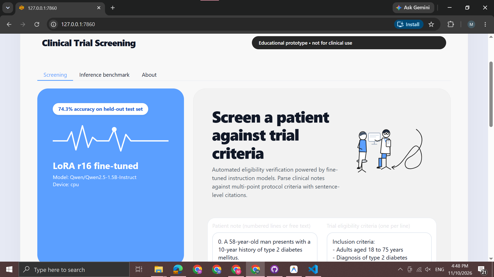
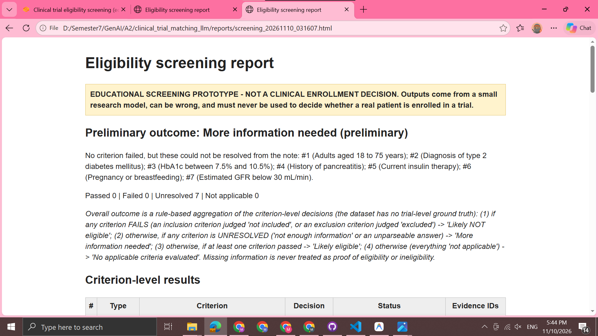
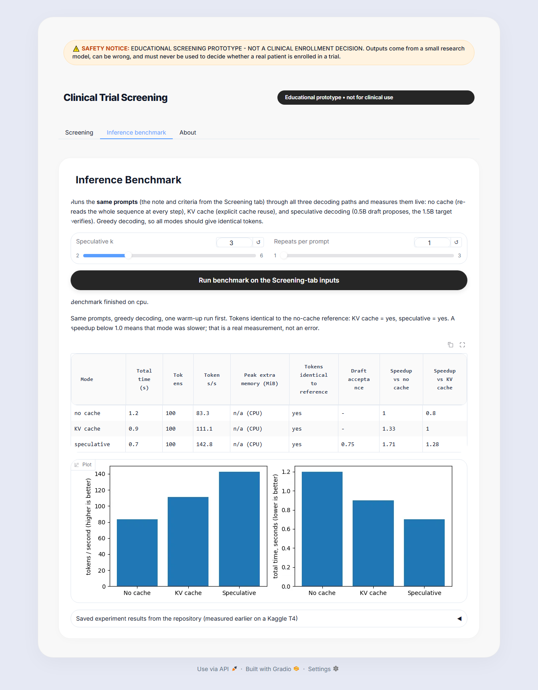
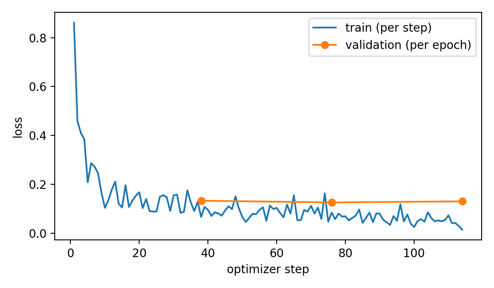
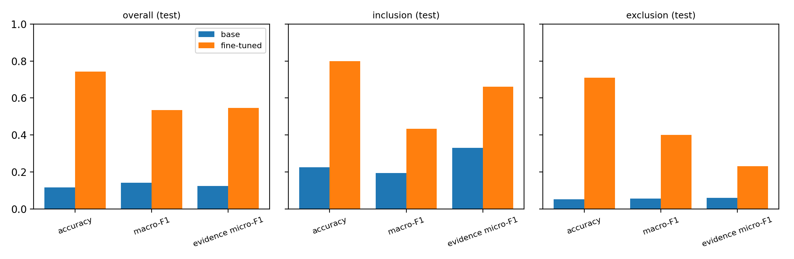

# Clinical Trial Eligibility Screening with a Fine-Tuned Small Transformer

Evidence-grounded, **criterion-level** eligibility screening: given a patient description and one inclusion or exclusion criterion, a LoRA-fine-tuned **Qwen2.5-1.5B-Instruct** returns one of six expert label categories and the IDs of the supporting sentences. The project also implements and validates three inference mechanisms from scratch (**KV-cached decoding, tiled online-softmax attention, greedy speculative decoding**) and ships a **browser application** with report export and a live decoding benchmark.

> ⚠️ **Educational screening prototype. Not a clinical enrollment decision.** The model is small, can be wrong, and must never be used to decide whether a real patient is enrolled in a trial.

| | |
|---|---|
| **Course** | Generative AI, Assignment 2 (FAST National University of Computer and Emerging Sciences, Islamabad) |
| **Author** | Maryam Fatima, Roll No. 23i-0788 |
| **Technical report (IEEE, LaTeX)** | [`report/main.pdf`](report/main.pdf) (source: [`report/main.tex`](report/main.tex)) |
| **Demo video (5–7 min)** | PASTE-VIDEO-LINK-HERE |
| **Fine-tuned adapter (target, 70 MB)** | [adapter_epoch_3.zip](https://github.com/Maryam-Faatima/clinical_trial_matching_llm/releases/download/v1.0/adapter_epoch_3.zip) |
| **Fine-tuned adapter (draft model)** | [adapter_draft_epoch_3.zip](https://github.com/Maryam-Faatima/clinical_trial_matching_llm/releases/download/v1.0/adapter_draft_epoch_3.zip) |
| **Defense notes** | [`UNDERSTANDING.md`](UNDERSTANDING.md) |

---

## Contents
1. [Headline results](#1-headline-results)
2. [Quick start: run the app](#2-quick-start-run-the-app)
3. [Using the application](#3-using-the-application)
4. [Repository structure](#4-repository-structure)
5. [Data and the fixed split](#5-data-and-the-fixed-split)
6. [Model, prompt and fine-tuning](#6-model-prompt-and-fine-tuning)
7. [Results in detail](#7-results-in-detail)
8. [Reproducing the experiments](#8-reproducing-the-experiments)
9. [Tests](#9-tests)
10. [Rubric evidence map](#10-rubric-evidence-map)
11. [Limitations and honest notes](#11-limitations-and-honest-notes)
12. [AI-use statement, acknowledgements, references](#12-ai-use-statement-acknowledgements-references)

---

## 1. Headline results

**Criterion-level eligibility, held-out test patients (8 patients, 206 rows)**

| | Before fine-tuning | After fine-tuning |
|---|---|---|
| Accuracy | 0.117 | **0.743** |
| Macro-F1 | 0.142 | **0.536** |
| Evidence micro-F1 | 0.124 | **0.546** |

A classifier that always answers "not excluded" would reach 0.442 accuracy. The main remaining error is **treating missing information as proof** (all 28 exclusion criteria whose correct label is "not enough information" were answered "not excluded"), analysed in [Section 7](#error-analysis).

**Inference mechanisms (Tesla T4, fp16, batch size 1)**

| Mechanism | Verified correctness | Measured result |
|---|---|---|
| **KV-cached decoding** (explicit cache, positions, masks) | Tokens identical to the uncached reference: 4/4 synthetic and 30/30 real prompts, fp16 and fp32 | **Up to 8.0× faster** (1024 + 128 tokens); constant ≈ 39 ms per token |
| **Tiled attention + online softmax** | 24/24 tests vs a float64 reference; max fp16 error 9.7 × 10⁻⁴; stable where naive softmax gives NaN | **125× less memory** at 4096 tokens, but **2.9× slower** than the reference and 55× slower than the fused PyTorch kernel |
| **Greedy speculative decoding** (0.5B draft, 1.5B target) | Tokens identical to ordinary greedy in every configuration; oracle (self-draft) acceptance = 1.00 | **No speedup** on this GPU (best 1.00×), explained by draft-step cost ≈ 0.8 of a target step |

---

## 2. Quick start: run the app

The application runs **locally in your browser**. No notebook, Kaggle, Colab or IDE is needed.

### Requirements
- Python 3.10 or newer (developed and tested with Python 3.13)
- About **5 GB of free disk space** (base model ≈ 3 GB, draft model ≈ 1 GB, adapter ≈ 70 MB, packages)
- **GPU (recommended):** any NVIDIA GPU with ≥ 6 GB memory (fp16, ≈ 0.6 s per criterion on a Tesla T4)
- **CPU only:** works (fp32) but is much slower; plan for ≥ 8 GB of RAM (estimated: 1.5B parameters × 4 bytes)
- Internet access on the first start (model download)

### Install and start

```bash
git clone https://github.com/Maryam-Faatima/clinical_trial_matching_llm.git
cd clinical_trial_matching_llm

python -m venv .venv
# Windows (PowerShell):  .venv\Scripts\Activate.ps1
# macOS / Linux:         source .venv/bin/activate

# NVIDIA GPU: first install the CUDA build of PyTorch from https://pytorch.org/get-started/locally/
# (the default pip wheel on Windows is CPU-only), then:
pip install -r requirements.txt

python app.py
```

Open **http://127.0.0.1:7860** in a browser.

**What happens on the first start**
1. The base model `Qwen/Qwen2.5-1.5B-Instruct` is downloaded from Hugging Face (≈ 3 GB, cached afterwards).
2. If `outputs/lora_r16/epoch_3/` is missing, the **fine-tuned adapter is downloaded automatically** from the GitHub release (≈ 70 MB). If this fails, download [adapter_epoch_3.zip](https://github.com/Maryam-Faatima/clinical_trial_matching_llm/releases/download/v1.0/adapter_epoch_3.zip) by hand and unzip it so that `adapter_config.json` and `adapter_model.safetensors` are in `outputs/lora_r16/epoch_3/`.
3. The adapter is merged into the base weights, the device is detected (`cuda` or `cpu`), and the page starts.
4. The 0.5B **draft model** for speculative decoding is loaded lazily the first time that mode or the benchmark is used (≈ 1 GB download).

**Optional: fine-tuned draft model.** Unzip [adapter_draft_epoch_3.zip](https://github.com/Maryam-Faatima/clinical_trial_matching_llm/releases/download/v1.0/adapter_draft_epoch_3.zip) so that its two adapter files are in `outputs/lora_draft/epoch_3/`. If the folder is absent, the base 0.5B draft is used (the app labels this). Outputs are identical either way; only the acceptance rate changes.

### Command-line options

| Option | Default | Meaning |
|---|---|---|
| `--port` | `7860` | Port of the web page |
| `--host` | `127.0.0.1` | Use `0.0.0.0` to open the page from another device |
| `--share` | off | Create a temporary public Gradio link |
| `--adapter` | `outputs/lora_r16/epoch_3` | Adapter folder (env var `ADAPTER_PATH` also works) |
| `--draft-adapter` | `outputs/lora_draft/epoch_3` | Draft adapter folder (env `DRAFT_ADAPTER_PATH`) |
| `--base`, `--draft-base` | Qwen2.5-1.5B / 0.5B Instruct | Hugging Face model ids |
| `--no-adapter` | off | **Testing only:** base model without fine-tuning (the page shows a warning) |

### Troubleshooting

| Symptom | Fix |
|---|---|
| `Could not get the fine-tuned adapter` | No internet or release unreachable: download the zip manually (see above) |
| Very slow responses | You are on the CPU. Use an NVIDIA GPU with the CUDA build of PyTorch (`python -c "import torch; print(torch.cuda.is_available())"` must print `True`) |
| CUDA out of memory | Close other GPU programs; the app needs ≈ 3 GB for the target (+ ≈ 1 GB for the draft in speculative mode) |
| `Address already in use` | Start with `--port 7861` |
| Warning about unauthenticated Hugging Face requests | Harmless; set `HF_TOKEN` only if downloads are rate-limited |
| Windows `UnicodeEncodeError` in a script | Open/write files with `encoding="utf-8"` (all repo scripts already do) |
| On Kaggle: `incompatible version of torchao` | `pip uninstall -y torchao` (a Kaggle-image issue, not needed here) |

---

## 3. Using the application



**Screening tab**
1. Pick an example and click **Load example**, or paste your own **patient note** (numbered lines like `0. ...` or free text) and **criteria**:
   ```text
   Inclusion criteria:
   - Adults aged 18 to 75 years
   Exclusion criteria:
   - History of pancreatitis
   ```
   (or one criterion per line prefixed with `Inclusion:` / `Exclusion:`).
2. Choose a **decoding mode**: *KV cache* (default), *No cache (reference)* or *Speculative decoding* (set the draft length *k*).
3. Click **Run screening**. For each criterion you get the **decision**, a **status** (✅ OK for eligibility, ❌ blocks eligibility, ⚠️ needs more information, ➖ not applicable), the **cited evidence sentences (exact text and IDs)**, a **templated explanation** and the raw model output.
4. The page shows a **preliminary overall outcome** and downloads of the **HTML and Markdown report** (also saved in `reports/`). Reports contain the disclaimer, the outcome, the evidence, and **provenance**: model, adapter and its source, device, precision, decoding mode and an input fingerprint.



**Overall outcome (explicit rule, not a ground-truth label).** Any criterion that *fails* (inclusion judged "not included", or exclusion judged "excluded") → **Likely NOT eligible**. Otherwise any *unresolved* criterion ("not enough information" or an unparseable answer) → **More information needed** (they are listed). Otherwise at least one pass → **Likely eligible**. All "not applicable" → **No applicable criteria evaluated**. **Missing information is never counted as eligibility or ineligibility.**

**Explanations** are built only from the predicted label and the cited sentences (no free text is generated). Cited sentence IDs that do not exist in the note are removed and reported.

**Inference benchmark tab**



Runs the **same prompts** through no cache, KV cache and speculative decoding after a warm-up pass and reports time, tokens/s, peak extra GPU memory, **token equality with the no-cache reference**, draft acceptance and speedups, plus a chart. A speedup below 1.0 is a real measurement, not an error. A collapsed section shows the saved offline experiment tables from `outputs/`.

**Input validation.** Empty note, missing inclusion/exclusion headings, a note over 8,000 characters, a criterion over 1,500 characters, more than 30 criteria, or a prompt over 1,536 tokens produce a friendly message (nothing is silently truncated). Model errors are caught and shown; the page stays usable.


---

## 4. Repository structure

```text
.
├── app.py                      # browser application (Gradio)
├── requirements.txt
├── src/
│   ├── prompts.py              # shared prompt, output schema, parser
│   ├── data_prep.py            # dataset loading, GPT-4 columns dropped, 37/8/8 split, leakage checks
│   ├── model_info.py           # model / tokenizer facts (params, layers, KV bytes/token)
│   ├── token_stats.py          # token lengths and truncation analysis
│   ├── train_lora.py           # LoRA fine-tuning (target and draft via env vars)
│   ├── evaluate.py             # evaluation (test split locked behind --allow-test)
│   ├── metrics.py              # accuracy, macro-F1, per-class, confusion, evidence P/R/F1
│   ├── analyze.py              # figures + error-case files
│   ├── kv_decode.py            # Task 3: cached and uncached decoders
│   ├── test_kv.py, bench_kv.py # Task 3: correctness and benchmark
│   ├── attention.py            # Task 4: reference and tiled online-softmax attention
│   ├── test_attention.py       # Task 4: correctness and benchmark
│   ├── speculative.py          # Task 5: greedy speculative decoding with cache rollback
│   ├── bench_spec.py           # Task 5: equality test and benchmark
│   ├── plot_spec_from_log.py   # rebuild Task 5 table/figure from the saved log
│   ├── screening.py            # app core: parsing, engine, aggregation, reports
│   ├── ui_theme.py             # app styling
│   ├── test_screening.py       # app logic tests (no model needed)
│   └── selftest_app.py         # real-model check of all three decoding modes
├── data/
│   ├── split_manifest.json     # patient IDs per split, counts, label counts
│   ├── excluded_rows.csv       # the one row excluded (missing criterion text)
│   └── processed/              # train/val/test .jsonl (no GPT-4 fields)
├── outputs/
│   ├── eval/                   # metrics + predictions: base, epochs 1-3 (val), test
│   ├── analysis/               # confusion matrices, charts, error cases and counts
│   ├── kv/                     # Task 3 results and chart
│   ├── attention/              # Task 4 results and chart
│   └── speculative/            # Task 5 results (rebuilt from the log) and chart
├── results/
│   ├── training/               # target training log + curves
│   └── training_draft/         # draft training log + curves
├── logs/                       # raw benchmark / training console logs
├── report/                     # IEEE paper: main.tex, references.bib, figures/, main.pdf
├── notebooks/                  # Kaggle notebook used to run the experiments
└── UNDERSTANDING.md            # defense notes
```
Large weights are **not** stored in git; they are attached to the [GitHub release v1.0](https://github.com/Maryam-Faatima/clinical_trial_matching_llm/releases/tag/v1.0).

---

## 5. Data and the fixed split

- **Dataset (only):** [`ncbi/TrialGPT-Criterion-Annotations`](https://huggingface.co/datasets/ncbi/TrialGPT-Criterion-Annotations): 1,015 annotated patient–criterion pairs from 53 synthetic patients; labels by three physicians. No other dataset is used.
- **Never used as input or in evaluation:** `gpt4_explanation`, `explanation_correctness`, `gpt4_sentences`, `gpt4_eligibility` (dropped right after loading; an assertion checks that no `gpt4*` column remains) and the dataset's own `training` flag.
- **Split:** sort unique patient IDs → `numpy.random.default_rng(42).shuffle` → first **37** train, next **8** validation, last **8** test. Every row of a patient is in exactly one split; set intersections are asserted empty. The manifest with all patient IDs is [`data/split_manifest.json`](data/split_manifest.json).
- **One excluded row:** a training row has no criterion text. It is excluded *after* splitting, logged in [`data/excluded_rows.csv`](data/excluded_rows.csv) and counted in the manifest, so the 37/8/8 split is unchanged. Usable rows: **602 / 206 / 206**.
- **Labels (all six kept, none collapsed):** inclusion: *included, not included, not enough information, not applicable*; exclusion: *excluded, not excluded, not enough information, not applicable*.

| Type | Label | Train | Val | Test |
|---|---|---:|---:|---:|
| Inclusion | included | 88 | 35 | 27 |
| | not included | 13 | 3 | 7 |
| | not enough information | 109 | 27 | 38 |
| | not applicable | 5 | 1 | 3 |
| Exclusion | excluded | 8 | 2 | 0 |
| | not excluded | 291 | 101 | 91 |
| | not enough information | 65 | 26 | 28 |
| | not applicable | 23 | 11 | 12 |

The data are strongly imbalanced, so **macro-F1 and per-class scores** are reported alongside accuracy. The test split contains no "excluded" example.

---

## 6. Model, prompt and fine-tuning

| | Target | Draft (speculative decoding) |
|---|---|---|
| Model | Qwen2.5-1.5B-Instruct | Qwen2.5-0.5B-Instruct |
| Parameters / fp16 weights | 1.544 B / 2.88 GiB | 0.494 B / 0.92 GiB |
| Layers / hidden size | 28 / 1536 | 24 / 896 |
| Query / KV heads, head dim | 12 / 2 (GQA), 128 | 14 / 2, 64 |
| KV cache per token (fp16) | 28,672 bytes | 12,288 bytes |
| Vocabulary / context | 151,936 / 32,768 | same tokenizer (verified) |
| Licence | Apache 2.0 | Apache 2.0 |

- **Prompt and output schema:** one shared builder ([`src/prompts.py`](src/prompts.py)) is used by training, evaluation and the app. Input: numbered note sentences, criterion type, criterion text, allowed labels. Output: `{"label": <label>, "evidence": [sentence ids]}`. Invalid outputs are counted as errors and never repaired.
- **Tokenization / truncation:** prompt + target tokens: train mean 294, max 589; val max 423; test max 483. Maximum training length is 1,024, so **no example is truncated**; the training code raises an error instead of truncating.
- **LoRA fine-tuning** ([`src/train_lora.py`](src/train_lora.py)): rank 16, α 32, dropout 0.05 on `q,k,v,o,gate,up,down`; 18,464,768 trainable parameters (1.18 %); loss on answer tokens only; AdamW, lr 2×10⁻⁴, cosine schedule, 10 % warm-up; 3 epochs, effective batch 16 (micro-batch 1 × 16 accumulation), fp16 autocast with fp32 adapter weights, gradient checkpointing, seed 42. 834 s and 7.95 GiB peak on a Kaggle T4. **The epoch is chosen by validation macro-F1** (epoch 3), not by loss; no hyperparameter search was run.
- **Evaluation protocol:** greedy decoding, repetition penalty 1.0, ≤ 64 new tokens, fp16. Evidence is scored on sentence-ID sets; the policy for empty sets (micro pooling; macro over rows with gold evidence; macro over all rows with correct abstention = 1; abstention and false-evidence rates) is in the paper, Section III-E.

---

## 7. Results in detail

### Validation: before and after fine-tuning (n = 206)

| Model | Val. loss | Accuracy | Macro-F1 | Evidence micro-F1 |
|---|---:|---:|---:|---:|
| Base | – | 0.107 | 0.118 | 0.128 |
| Epoch 1 | 0.1327 | 0.728 | 0.353 | 0.459 |
| Epoch 2 | 0.1255 | 0.752 | 0.444 | 0.541 |
| **Epoch 3 (selected)** | 0.1300 | 0.767 | 0.574 | 0.558 |



### Held-out test (n = 206; inclusion 75, exclusion 131)

| Model | Subset | Acc. | Macro-F1 | Evidence P | R | F1 |
|---|---|---:|---:|---:|---:|---:|
| Base | Overall | 0.117 | 0.142 | 0.075 | 0.362 | 0.124 |
| **Fine-tuned** | Overall | **0.743** | **0.536** | 0.530 | 0.564 | 0.546 |
| Base | Inclusion | 0.227 | 0.195 | 0.323 | 0.339 | 0.331 |
| Fine-tuned | Inclusion | 0.800 | 0.433 | 0.588 | 0.758 | 0.662 |
| Base | Exclusion | 0.053 | 0.057 | 0.033 | 0.406 | 0.062 |
| Fine-tuned | Exclusion | 0.710 | 0.400 | 0.300 | 0.188 | 0.231 |

Per-class (fine-tuned, test): included F1 0.898 (27); not included 0.000 (7); not enough information 0.639 (66); not applicable 0.316 (15); not excluded 0.826 (91). Macro-F1 averages the five labels that occur in the test gold labels or predictions. Full confusion matrices: [`outputs/analysis/confusion_test.png`](outputs/analysis/confusion_test.png). Metrics and per-row predictions: [`outputs/eval/`](outputs/eval/).



### Error analysis

53 label errors on the test split ([`outputs/analysis/error_cases_test.md`](outputs/analysis/error_cases_test.md) lists 12 representative cases, three per type; the paper discusses them):

| Type | Count |
|---|---:|
| Missing information treated as proof | 28 |
| False "not enough information" | 15 |
| Not-applicable confusion | 10 |
| Wrong decision polarity | 0 |
| Correct label, different evidence set (additional) | 37 |

### Task 3: KV cache vs no cache (Tesla T4, fp16, batch 1; tokens identical in every row)

| Input + output | No cache tok/s | KV cache tok/s | Speedup | Prefill ms | Decode ms/token |
|---|---:|---:|---:|---:|---:|
| 128 + 32 | 22.9 | 25.7 | 1.1× | 46 | 38.7 |
| 128 + 128 | 20.1 | 25.8 | 1.3× | 47 | 38.8 |
| 512 + 32 | 6.9 | 24.3 | 3.5× | 113 | 38.9 |
| 512 + 128 | 6.6 | 25.3 | 3.8× | 115 | 39.0 |
| 1024 + 32 | 3.3 | 21.6 | 6.6× | 275 | 38.9 |
| 1024 + 128 | 3.1 | 24.7 | **8.0×** | 274 | 38.6 |

Max absolute logit difference cached vs uncached: 0.04–0.056 (fp16), 1–2 × 10⁻⁴ (fp32): rounding, not a cache bug. Details: [`outputs/kv/`](outputs/kv/).

### Task 4: attention (fp16, causal, 12 heads, head dim 128)

| Length | Reference ms / MiB | Tiled (Python) ms / MiB | PyTorch memory-efficient ms / MiB |
|---:|---|---|---|
| 1024 | 4.44 / 156 | 14.70 / 9.8 | 0.33 / 3.0 |
| 2048 | 16.87 / 600 | 51.13 / 12.8 | 1.12 / 6.0 |
| 4096 | 66.97 / 2352 | 191.28 / 18.8 | 3.48 / 12.0 |

The tiled implementation is a Python loop with many small GPU launches, so it saves **memory** but not **time**; a fused kernel keeps tiles on-chip. FlashAttention kernels need compute capability ≥ 8.0 (the T4 is 7.5). Details: [`outputs/attention/`](outputs/attention/).

### Task 5: speculative decoding (40 real validation prompts; baseline cached greedy 24.9 tok/s)

| Draft | k | Acceptance | Tokens/round | Speedup |
|---|---:|---:|---:|---:|
| Target itself (oracle control) | 2 / 4 / 6 | 1.00 | 2.70 / 4.46 / 6.37 | 0.88 / 0.86 / 0.87 |
| Base 0.5B | 2 / 4 / 6 | 0.84 / 0.80 / 0.73 | 2.38 / 3.54 / 4.50 | 0.91 / 0.83 / 0.76 |
| Fine-tuned 0.5B | 2 / 4 / 6 | 0.96 / 0.93 / 0.93 | 2.61 / 4.14 / 5.79 | **1.00** / 0.96 / 0.96 |

Hugging Face assisted generation (reference, k = 4): 0.90× / 0.98× (base / fine-tuned draft). A simple model, speedup ≈ τ / (1 + k·c), fits a draft-to-target step cost of c ≈ 0.8. Raw log: [`logs/task5_speculative_benchmark.log`](logs/task5_speculative_benchmark.log); table and chart rebuilt by [`src/plot_spec_from_log.py`](src/plot_spec_from_log.py).

---

## 8. Reproducing the experiments

All experiments ran on a free **Kaggle notebook (Tesla T4, 14.56 GiB)**. From a fresh clone (GPU needed for model steps; install `requirements.txt` first, and on Kaggle run `pip uninstall -y torchao`):

```bash
# Data and model facts
python -m src.data_prep                       # split, manifest, leakage checks
python -m src.model_info
python -m src.token_stats

# Task 1: before / after on validation
python -m src.evaluate --split val --name base_val
python -m src.train_lora                      # → outputs/lora_r16/epoch_{1,2,3}
python -m src.evaluate --split val --adapter outputs/lora_r16/epoch_1 --name ft_e1_val   # also epoch_2, epoch_3

# Final test evaluation: run ONCE, after the epoch has been chosen on validation
python -m src.evaluate --split test --name base_test --allow-test
python -m src.evaluate --split test --adapter outputs/lora_r16/epoch_3 --name ft_e3_test --allow-test

# Task 2: figures and error cases (CPU only, reads outputs/eval/)
python -m src.analyze --split test --base base_test --ft ft_e3_test
python -m src.analyze --split val  --base base_val  --ft ft_e3_val

# Task 3, 4
python -m src.test_kv && python -m src.test_kv --dtype fp32 && python -m src.bench_kv
python -m src.test_attention

# Task 5: first fine-tune the draft (Linux/macOS syntax; PowerShell: $env:BASE_MODEL="..." ; $env:OUT_DIR="...")
BASE_MODEL=Qwen/Qwen2.5-0.5B-Instruct OUT_DIR=outputs/lora_draft python -m src.train_lora
python -m src.bench_spec --hf-ref
python -m src.bench_spec --dtype fp32 --n 20 --ks 4 --repeats 1 --name spec_fp32
python -m src.plot_spec_from_log              # rebuilds table/figure from logs/ (CPU)
```

- **Determinism:** seed 42; retraining the 1.5B target and the 0.5B draft reproduced the original validation losses exactly.
- **T4 specifics:** fp16 (no bfloat16), micro-batch 1 with 16 accumulation steps and gradient checkpointing (micro-batches of 2 and 4 ran out of memory).
- **Kaggle files vanish when the session ends:** download results immediately. The Kaggle notebook used for the runs is in [`notebooks/`](notebooks/).
- **Rebuild the paper:** `cd report && pdflatex main && bibtex main && pdflatex main && pdflatex main`.

---

## 9. Tests

```bash
python -m src.test_screening     # app logic (parsing, decisions, aggregation, reports); no model needed
python -m src.selftest_app       # real model: one example in all three decoding modes must give identical tokens
python -m src.test_kv            # cached == uncached greedy tokens, 4 synthetic + 30 real prompts
python -m src.test_attention     # tiled vs reference attention: 8 cases × 3 precisions + causality + stability
```
`bench_spec.py` also checks token equality of every speculative configuration against ordinary greedy decoding.

---

## 10. Rubric evidence map

| Rubric | Where to look |
|---|---|
| **A1** literature, comparison | Paper Section II and Table I; 16 references in [`report/references.bib`](report/references.bib) |
| **A2** model choice, feasibility | [Section 6](#6-model-prompt-and-fine-tuning); paper Table III; `src/model_info.py` |
| **A3** decisions, alternatives, difficulties | Paper III-B, III-D; [`UNDERSTANDING.md`](UNDERSTANDING.md) ("Problems I hit") |
| **B1** dataset integrity, split | [Section 5](#5-data-and-the-fixed-split); `src/data_prep.py`; `data/split_manifest.json` |
| **B2** input/output processing | `src/prompts.py`; `src/token_stats.py`; GPT-4 fields dropped in `data_prep.py` |
| **B3** fine-tuning | `src/train_lora.py`; `results/training/` (log, curves); adapter in the release |
| **B4** before/after | `outputs/eval/*base*` vs `*ft_e*`; [Section 7](#7-results-in-detail) |
| **C1, C2** labels, class metrics | `src/metrics.py`; `outputs/eval/*_metrics.json`; `outputs/analysis/confusion_*.png` |
| **C3** evidence | `src/metrics.py` (`evidence_metrics`, empty-set policy); test table |
| **C4** failure analysis | `outputs/analysis/error_cases_*.md` (12 test + 14 validation cases), `error_counts_*.json` |
| **D1–D3** KV cache | `src/kv_decode.py`, `src/test_kv.py`, `src/bench_kv.py`, `outputs/kv/` |
| **E1–E3** attention | `src/attention.py`, `src/test_attention.py`, `outputs/attention/` |
| **F1–F3** speculative decoding | `src/speculative.py`, `src/bench_spec.py`, `logs/task5_speculative_benchmark.log`, `outputs/speculative/` |
| **G1–G4** application | [Sections 2–3](#2-quick-start-run-the-app); `app.py`, `src/screening.py`; screenshots in `report/figures/` |
| **H1** paper | [`report/main.pdf`](report/main.pdf) |
| **H2** reproducible source, video | This README; `requirements.txt`; split manifest; logs; demo video link at the top |
| **H3** defense | [`UNDERSTANDING.md`](UNDERSTANDING.md) |

---

## 11. Limitations and honest notes

- **Small data:** 602 training rows from 37 patients; the test set has 8 patients, no "excluded" example and only 7 "not included". Single run and seed, no confidence intervals; the notes are synthetic vignettes.
- **Main model weakness:** missing information is read as "not excluded" for exclusion criteria; rare labels (not included, not applicable) are largely missed. Class weighting, oversampling, a larger model, more epochs and a hyperparameter search were not tried.
- **Strict evidence metric:** exact sentence-ID matching understates useful citations.
- **Hardware:** all timings are from one T4 at batch size 1, where decoding is overhead-bound; conclusions about speculative decoding and tiling may differ on other hardware. FlashAttention kernels could not be tested.
- **Speculative-decoding provenance:** the original result JSON files of that benchmark were lost in a notebook reset; the tables are rebuilt from the saved console log. The draft adapter was retrained afterwards and reproduced the original validation losses.
- **Precision:** reported accuracies are fp16 on a GPU; on a CPU (fp32) rare output differences are possible.
- **The overall verdict is a rule-based aggregation**, not validated against any ground truth. The system is not validated for clinical use.

---

## 12. AI-use statement, acknowledgements, references

**AI use.** An AI assistant (Claude, Anthropic) was used to plan the work, draft and debug code, and draft the text of the paper and this README. The author ran all training and experiments, checked the reported numbers against the saved logs and result files, tested the code, and is responsible for the content. The TrialGPT code repository was **not** run (the dataset only); Hugging Face assisted generation was used solely as a reference for testing speculative decoding.

**Acknowledgements.** Dataset: NCBI [TrialGPT Criterion Annotations](https://huggingface.co/datasets/ncbi/TrialGPT-Criterion-Annotations). Models: Qwen2.5 (Apache 2.0). Libraries: PyTorch, Transformers, PEFT, scikit-learn, NumPy, pandas, Matplotlib, Gradio. No code licence is declared for this coursework repository; models and data keep their original licences.

**Main references** (full list in the paper)
- Q. Jin et al., "Matching patients to clinical trials with large language models," *Nature Communications*, 2024.
- M. Nievas et al., "Distilling large language models for matching patients to clinical trials," *JAMIA*, 2024.
- E. J. Hu et al., "LoRA," ICLR 2022; T. Dettmers et al., "QLoRA," NeurIPS 2023.
- M. Milakov and N. Gimelshein, "Online normalizer calculation for softmax," 2018; T. Dao et al., "FlashAttention," NeurIPS 2022; T. Dao, "FlashAttention-2," ICLR 2024.
- Y. Leviathan et al., "Fast inference from transformers via speculative decoding," ICML 2023; C. Chen et al., "Accelerating LLM decoding with speculative sampling," 2023.